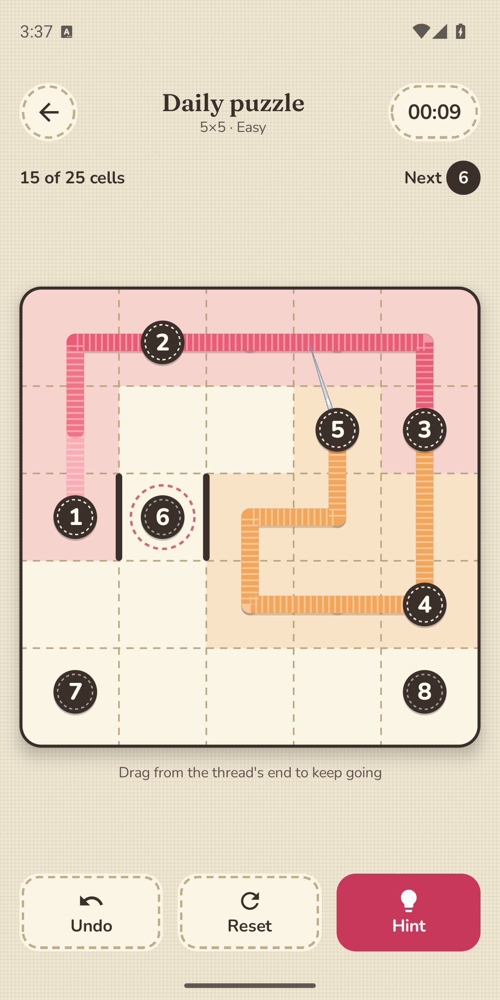
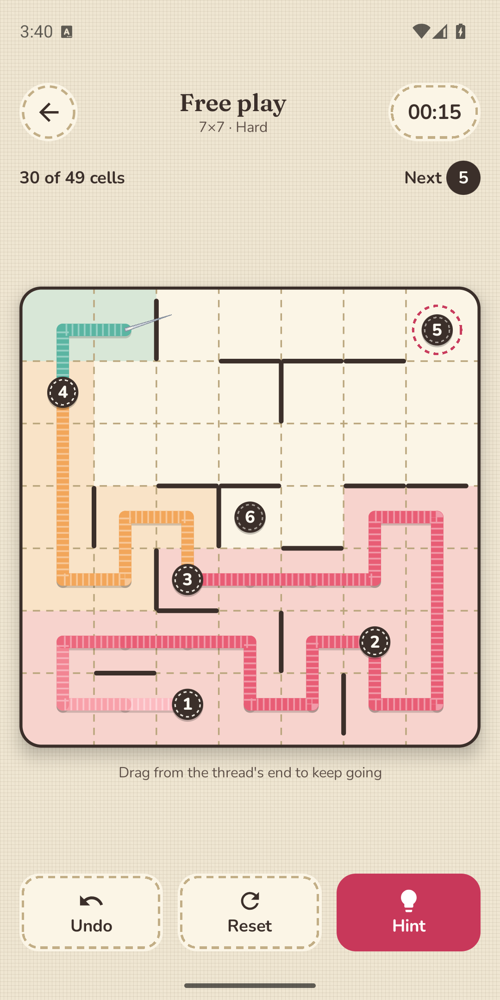
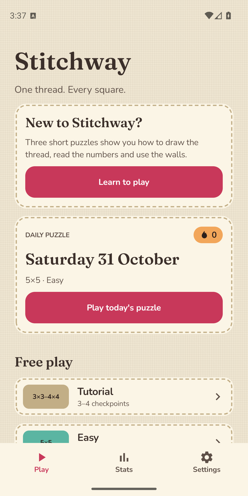
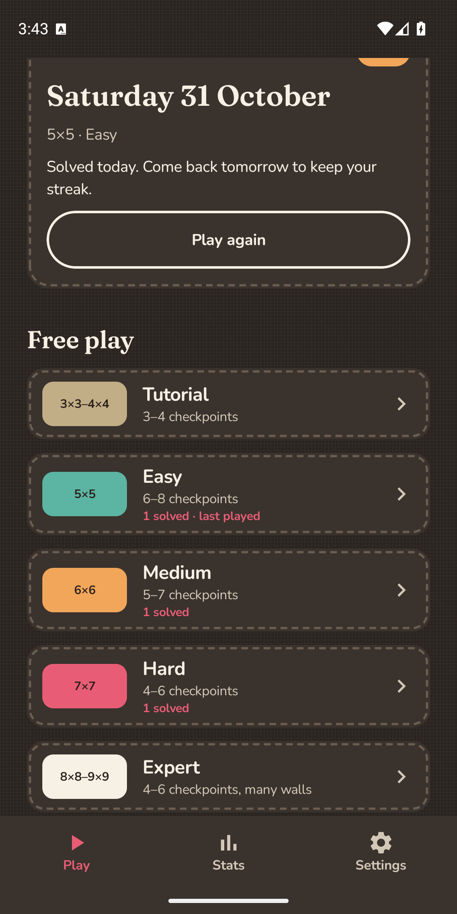

# Stitchway

**One thread. Every square.**

Stitchway is a calm, offline path puzzle for Android. Start at 1 and draw a single thread through the numbered stitches in order, filling every square exactly once. Walls block the way, and every puzzle has exactly one solution.

  
  
  
  

## Features

- A daily puzzle, the same for everyone, with streaks and a calendar of your solves
- Free play in five tiers (Tutorial, Easy, Medium, Hard, Expert), from 3×3 to 9×9
- Endless generated puzzles, each checked for a single solution
- Undo, reset, hints, and save-and-resume for a half-finished puzzle
- Light and dark themes, a colour-blind friendly palette, reduce-motion and haptics options
- Screen reader support, with moves available as actions instead of dragging
- No account needed, and puzzles work offline
- Free with ads (a banner after each solve and a full-screen ad every fifth puzzle); a one-time purchase removes them

## Get it

Coming soon to Google Play.

## Report a problem

[Open an issue](https://github.com/retr0soft/stitchway/issues/new). Issues are public, so please leave out anything private.

## Privacy

The game keeps your progress on your device. Ads are served by Google AdMob, which asks for consent where required. See the [privacy policy](PRIVACY.md).

## Contact

devretr0soft@gmail.com
